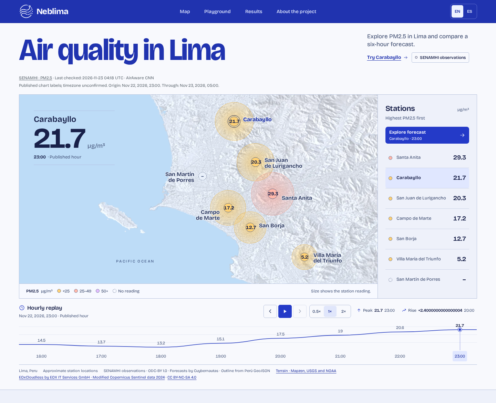

# Neblima

Neblima pronostica la concentración de partículas finas (PM2.5) en Lima, Perú.
Usa 24 mediciones horarias consecutivas de una estación para estimar las seis
horas siguientes. El equipo Cuybernautas desarrolló el proyecto para el
[reto de TimeNet](https://challenge.timenet.ai/).

[Demo interactiva](https://neblima.orbitly.lat/) ·
[README en inglés](README.md) · [Documentación técnica en inglés](docs/README.md)

[](https://neblima.orbitly.lat/)

## Explora la demo

Elige una estación en el mapa o en el panel de pronóstico. Cambia la hora de
origen y compara las seis predicciones con las observaciones disponibles y
con persistencia, la referencia que repite la última lectura. Para revisar
la evidencia, abre los resultados históricos. La demo es una herramienta de
investigación y usa las horas publicadas por el proveedor. La zona horaria de
las gráficas recientes y su disponibilidad histórica en tiempo real siguen
pendientes de confirmación. [Guía de la demo en inglés](docs/demo.md)

## Qué encontramos

En la prueba histórica reservada, Qwen redujo el error absoluto medio de
6,446 a 4,994 µg/m³ frente a persistencia, una mejora de 22,52 % en 50 789
ventanas solapadas. En los archivos externos de OpenAQ y del Servicio Nacional
de Meteorología e Hidrología del Perú (SENAMHI), Gemma 3 1B con la corrección
de picos obtuvo menor error en horas de concentración alta. La red
convolucional obtuvo menor error general en ambos archivos.
[Prueba reservada](reports/models/prueba-reservada-lima.md) ·
[Evaluación de Gemma](reports/models/validacion-gemma.md)

## Empieza en tu equipo

Instala Git, Make y [uv](https://docs.astral.sh/uv/getting-started/installation/).
El paquete y el comando conservan el nombre técnico `airaware`.

```bash
git clone https://github.com/keneth-arias/Neblima.git
cd Neblima
uv python install
make setup
make init
make doctor
UV_OFFLINE=true make check
```

La instalación necesita internet. Luego puedes validar el catálogo y ejecutar
las pruebas sin credenciales ni datos ambientales remotos. La
[guía de inicio en inglés](docs/getting-started.md) explica cómo reproducir
el flujo completo con datos sintéticos y cómo trabajar con originales locales.

## Equipo y licencias

Keneth Arias (@keneth-arias), Cristopher (@qriqs) y Jordan (@J0r-PS) integran
Cuybernautas. El código de Neblima usa [AGPL-3.0-only](LICENSE) y la base
histórica de SENAMHI usa Open Data Commons Attribution License 1.0.
[Atribución de datos](DATA_ATTRIBUTION.md) ·
[Guía para contribuir en inglés](CONTRIBUTING.md)
