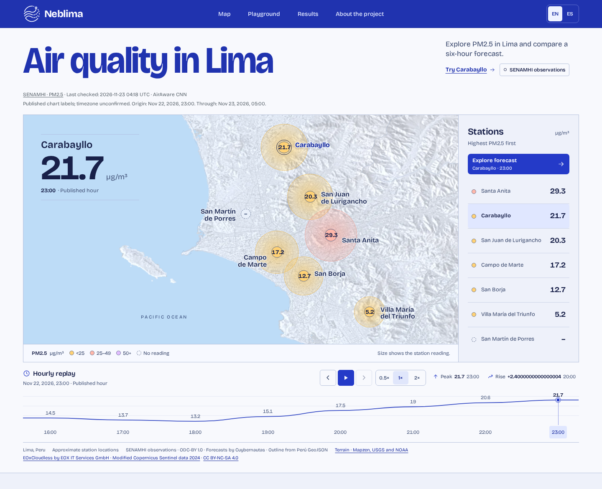

<p align="center">
  
</p>

<h1 align="center">Neblima</h1>

<p align="center">
  <strong>Six-hour air quality forecasts for Lima, Peru</strong><br>
  Replay station readings and see what the next six hours could look like.
</p>

<p align="center">
  <a href="https://neblima.orbitly.lat/">Open the demo</a> ·
  <a href="docs/README.md">Documentation</a> ·
  <a href="docs/evaluation.md">Evaluation</a> ·
  <a href="README.es.md">Español</a>
</p>

<p align="center">
  <a href="https://neblima.orbitly.lat/">
    
  </a>
</p>

<p align="center"><sub>Dashboard capture · November 23, 2026 · <a href="docs/demo.md#image-credits">Image credits</a></sub></p>

Neblima uses **24 consecutive hourly observations** of fine particulate
matter (PM2.5) from one station to predict **the next six hourly values**.
In the demo, you can explore seven Lima monitoring sites, choose a station and
forecast origin, and compare the forecast with available observations and a
baseline that repeats the last reading. The Cuybernautas team built Neblima for
the [TimeNet challenge](https://challenge.timenet.ai/).

## What the evaluation found

On the frozen historical test, **Qwen reduced mean absolute error (MAE) by
22.52%** against persistence, from **6.446 to 4.994 µg/m³** across 50,789
forecast windows. Those windows overlap and cover 51,319 distinct station-hours.
[Held-out test report (Spanish)](reports/models/prueba-reservada-lima.md)

On frozen archives from OpenAQ and Peru's National Meteorology and Hydrology
Service (SENAMHI), corrected **Gemma 3 1B** lowered error during high-concentration
hours, while the convolutional neural network (CNN) had lower overall MAE in
both archives. Find the source-by-source numbers, the later replay, and the PM10
experiment in the [evaluation guide](docs/evaluation.md).

Neblima is a research demo for exploring hourly concentrations. The recent
SENAMHI charts use provider-published times with an unconfirmed time zone, and
the evaluations are retrospective. The project has yet to validate real-time
availability or regulatory use. [Dataset card](docs/dataset-cards/lima-pm25-forecast.md)

## Run it locally

Install Git, Make, and [uv](https://docs.astral.sh/uv/getting-started/installation/).
Neblima was originally called AirAware, so the Python package, command-line tool,
and TimeF dataset namespace still use `airaware`.

```bash
git clone https://github.com/keneth-arias/Neblima.git
cd Neblima
uv python install
make setup
make init
make doctor
UV_OFFLINE=true make check
```

Setup installs the pinned Python 3.13.13 environment and dependencies. After
setup, the commands above need no provider credentials or air quality downloads.
Replay the data pipeline with synthetic inputs, or start from an authorized
local copy of the original data. [Getting started](docs/getting-started.md)

## From source file to forecast

The project keeps original files and their acquisition receipts, normalizes
observations with row-level provenance, and builds hourly series without filling
missing readings. It assigns complete windows to chronological splits and
exports them to TimeF, TimeNet's time-series dataset format. The historical
SENAMHI release contains **338,892 forecasting tasks** across seven provisional
station identities. [Architecture](ARCHITECTURE.md) ·
[Dataset card](docs/dataset-cards/lima-pm25-forecast.md) ·
[TimeNet connector](https://github.com/OpenTSLM/TimeNet/pull/796)

## Explore the station map

GitHub renders the historical station locations below. Coordinates are
approximate because the source file doesn't declare a coordinate reference
system. For a standalone map, see [embedding the map](docs/demo.md#embed-the-station-map).

```geojson
{
  "type": "FeatureCollection",
  "features": [
    {"type": "Feature", "id": "CAMPO_DE_MARTE", "properties": {"Estación": "Campo de Marte"}, "geometry": {"type": "Point", "coordinates": [-77.0432, -12.0705]}},
    {"type": "Feature", "id": "CARABAYLLO", "properties": {"Estación": "Carabayllo"}, "geometry": {"type": "Point", "coordinates": [-77.0336, -11.9022]}},
    {"type": "Feature", "id": "SANTA_ANITA", "properties": {"Estación": "Santa Anita"}, "geometry": {"type": "Point", "coordinates": [-76.9714, -12.043]}},
    {"type": "Feature", "id": "SAN_BORJA", "properties": {"Estación": "San Borja"}, "geometry": {"type": "Point", "coordinates": [-77.0077, -12.1086]}},
    {"type": "Feature", "id": "SAN_JUAN_DE_LURIGANCHO", "properties": {"Estación": "San Juan de Lurigancho"}, "geometry": {"type": "Point", "coordinates": [-76.9992, -11.9816]}},
    {"type": "Feature", "id": "SAN_MARTIN_DE_PORRES", "properties": {"Estación": "San Martín de Porres"}, "geometry": {"type": "Point", "coordinates": [-77.0845, -12.0089]}},
    {"type": "Feature", "id": "VILLA_MARIA_DEL_TRIUNFO", "properties": {"Estación": "Villa María del Triunfo"}, "geometry": {"type": "Point", "coordinates": [-76.92, -12.1664]}}
  ]
}
```

## Team and licenses

**Cuybernautas** · Keneth Arias (@keneth-arias), Cristopher (@qriqs), and
Jordan (@J0r-PS). To help improve the pipeline or documentation, see the
[contribution guide](CONTRIBUTING.md).

Neblima's code uses the [GNU Affero General Public License v3 only](LICENSE).
SENAMHI's historical Lima air quality database uses the Open Data Commons
Attribution License 1.0. Other products have their own terms. [Data attribution](DATA_ATTRIBUTION.md)
