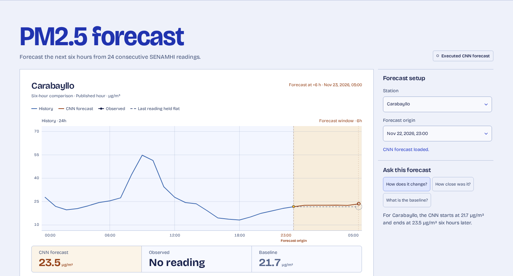

# Explore the Neblima demo

The public demo lets you inspect fine particulate matter (PM2.5) across
seven Lima monitoring sites and compare six-hour forecasts with known
observations. Open the [Neblima dashboard](https://neblima.orbitly.lat/).

## Read the dashboard

Start on **Map** to see station readings in micrograms per cubic meter
(µg/m³). Switch stations using a marker or the station list. Use **Hourly
replay** to step through published hours. A dash marks a missing observation.

In **Playground**, choose a station and a **Forecast origin**. That origin is
the last hour in the 24-reading input. The chart then shows up to six hourly
predictions, any observed target values, and a flat persistence baseline
equal to the last input reading. Use **View data** to read the individual
values. Check the model name next to the forecast to identify the displayed
run.

[](https://neblima.orbitly.lat/#playground)

The November 23, 2026 capture shows an AirAware convolutional neural network
(CNN) forecast. The repository also implements a Gemma 3 1B export path.
The model name in the deployed interface identifies the forecast available
for a given snapshot. [Refresh pipeline](../tools/web-refresh/README.md)

## Interpret the time labels

The recent charts from Peru's National Meteorology and Hydrology Service
(SENAMHI) show provider-published hours with an unconfirmed time zone. The
demo records the capture timestamp separately in Coordinated Universal Time
(UTC). Read the source stamp and forecast origin when comparing different
snapshots. Missing target readings may become available later.

Under **Results**, the historical Carabayllo and San Juan de Lurigancho cases
show where Qwen gained or lost accuracy against persistence. The historical
test covers seven provisional station identities. For the full comparisons
and scope, see the [evaluation guide](evaluation.md).

## Embed the station map

You can reuse the standalone [station map](../web/estaciones.html) on a static
site. Copy the file into a `mapas/` folder beside the host page, then insert
the following frame. The relative path also works when the host site lives
in a subdirectory.

```html
<iframe src="./mapas/estaciones.html"
  title="Seven air quality monitoring sites in Lima"
  height="720" loading="lazy" style="display: block; width: 100%; border: 0">
</iframe>
```

The map loads Leaflet from `unpkg.com` and OpenStreetMap tiles from
`tile.openstreetmap.org`. It needs no build step or API key. The station
links remain available without JavaScript. Coordinates come from the
[`stations` configuration](../configs/weather-alignment.yaml) and are
approximate because the original source omits its coordinate reference
system. Keep the map credits and [data attribution](../DATA_ATTRIBUTION.md)
with the embed.

## Image credits

The README and this guide use captures of the public Neblima demo from
November 23, 2026. The playground capture is cropped to the forecast
chart and controls. Station observations are from SENAMHI under the Open Data
Commons Attribution License 1.0. Forecasts are by Cuybernautas. The dashboard
credits Perú GeoJSON for its outline and Mapzen, the US Geological Survey,
and the National Oceanic and Atmospheric Administration for terrain.
EOxCloudless by EOX IT Services GmbH uses modified Copernicus Sentinel data
2024 under [CC BY-NC-SA 4.0](https://creativecommons.org/licenses/by-nc-sa/4.0/).
The Neblima mark comes from the [demo's site icon](https://neblima.orbitly.lat/icon.svg?icon.31vnvx-jt86wl.svg).
