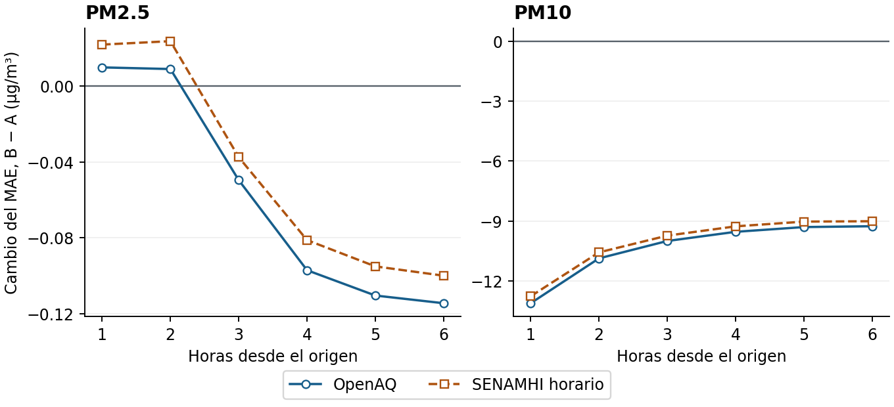

# ¿Cuánto aporta la historia de PM10 al pronóstico de seis horas en Lima?

**Conocer las últimas 24 horas de PM10 redujo casi a la mitad el error al pronosticar PM10.** En OpenAQ, el error absoluto medio (MAE) bajó de 21,460 a 11,117 µg/m³. En SENAMHI horario bajó de 20,979 a 10,922 µg/m³. La reducción se observa en cada uno de los seis horizontes. Con ambos canales, el modelo también superó a la persistencia en el promedio de las seis horas de cada fuente.

Para **PM2.5**, la reducción media fue de **0,059 µg/m³ en OpenAQ** y **0,045 µg/m³ en SENAMHI horario**. En ambas fuentes, añadir PM10 aumentó ligeramente el error a +1 y +2 horas y lo redujo de +3 a +6 horas. El efecto varió por estación. En San Borja, por ejemplo, aumentó ligeramente el error de PM2.5 en ambas fuentes.

## Resultados por proveedor

A usa la historia de PM2.5 y B usa las historias de PM2.5 y PM10. Ambos pronostican los dos contaminantes. Cada modelo entregó **1 026 456** predicciones en las **85 538** ventanas de OpenAQ y **1 233 216** en las **102 768** de SENAMHI horario. Los errores y diferencias de las tablas se expresan en µg/m³.

| Fuente | Contaminante | Objetivos | Horas de estación | MAE A | MAE B | Persistencia | B − A |
| --- | --- | ---: | ---: | ---: | ---: | ---: | ---: |
| OpenAQ | PM2.5 | 513 228 | 87 648 | 5,794 | 5,735 | 7,170 | −0,059 |
| OpenAQ | PM10 | 513 228 | 87 648 | 21,460 | 11,117 | 13,807 | −10,342 |
| SENAMHI horario | PM2.5 | 616 608 | 105 333 | 5,579 | 5,534 | 6,906 | −0,045 |
| SENAMHI horario | PM10 | 616 608 | 105 333 | 20,979 | 10,922 | 13,567 | −10,057 |

## Horizonte y estación



Las escalas verticales de los paneles son distintas. Cada fila de la tabla conserva el código del proveedor. En OpenAQ, el código `6501061` de San Juan de Lurigancho solo aporta tres ventanas. En ellas B aumentó el error de PM10 en 4,814 µg/m³. En las 12 607 ventanas del código `7464` del mismo sitio, lo redujo en 8,457 µg/m³. Para Carabayllo no se formaron ventanas completas en OpenAQ.

| Fuente | Estación (código) | Ventanas | Horas de estación | B − A PM2.5 | B − A PM10 |
| --- | --- | ---: | ---: | ---: | ---: |
| OpenAQ | Campo de Marte (`2415`) | 15 191 | 15 501 | −0,076 | −9,488 |
| OpenAQ | San Borja (`2402`) | 15 267 | 15 537 | 0,030 | −8,158 |
| OpenAQ | San Juan de Lurigancho (`6501061`) | 3 | 8 | −0,078 | 4,814 |
| OpenAQ | San Juan de Lurigancho (`7464`) | 12 607 | 12 997 | −0,181 | −8,457 |
| OpenAQ | San Martín de Porres (`2351`) | 14 983 | 15 338 | −0,092 | −13,817 |
| OpenAQ | Santa Anita (`2397`) | 14 864 | 15 224 | −0,048 | −11,198 |
| OpenAQ | Villa María del Triunfo (`2302`) | 12 623 | 13 043 | 0,004 | −10,767 |
| SENAMHI horario | Campo de Marte (`112194`) | 18 116 | 18 496 | −0,066 | −8,756 |
| SENAMHI horario | Carabayllo (`113260`) | 2 042 | 2 102 | 0,236 | −7,748 |
| SENAMHI horario | San Borja (`00112270`) | 17 183 | 17 478 | 0,029 | −8,508 |
| SENAMHI horario | San Juan de Lurigancho (`113258`) | 15 180 | 15 640 | −0,152 | −8,165 |
| SENAMHI horario | San Martín de Porres (`00112272`) | 17 777 | 18 207 | −0,081 | −12,957 |
| SENAMHI horario | Santa Anita (`00112271`) | 17 279 | 17 709 | −0,023 | −11,481 |
| SENAMHI horario | Villa María del Triunfo (`112233`) | 15 191 | 15 701 | −0,015 | −10,547 |

El desglose completo reúne errores de A, B y persistencia, sus diferencias, el número de predicciones y las horas de estación para cada combinación de estación, horizonte y contaminante. [Métricas de OpenAQ](../../metadata/prueba-pm25-pm10-openaq.json) · [Métricas de SENAMHI horario](../../metadata/prueba-pm25-pm10-senamhi-horario.json).

## Concentraciones altas

Una observación entra en este grupo si iguala o supera el percentil 95 de su contaminante en el sitio histórico correspondiente. El cálculo usó únicamente las 268 567 horas de estación distintas de las historias de entrenamiento. Los códigos externos se asocian al sitio provisional registrado, conservando cada código y sensor en su propia fuente. Estos umbrales describen la distribución histórica de cada sitio.

| Fuente | Contaminante | Objetivos | Horas de estación | MAE A | MAE B | Persistencia | B − A |
| --- | --- | ---: | ---: | ---: | ---: | ---: | ---: |
| OpenAQ | PM2.5 | 34 781 | 5 931 | 18,343 | 18,249 | 18,284 | −0,094 |
| OpenAQ | PM10 | 20 264 | 3 473 | 58,914 | 39,384 | 39,908 | −19,530 |
| SENAMHI horario | PM2.5 | 37 838 | 6 435 | 18,267 | 18,199 | 18,292 | −0,068 |
| SENAMHI horario | PM10 | 22 436 | 3 834 | 60,782 | 40,575 | 41,176 | −20,207 |

Para PM10 alto, añadir su historial redujo el MAE en 19,530 µg/m³ en OpenAQ y 20,207 µg/m³ en SENAMHI. En ese subconjunto, la ventaja de B frente a persistencia fue de 0,524 y 0,601 µg/m³, respectivamente. Para PM2.5 alto, esa ventaja frente a persistencia fue inferior a 0,1 µg/m³ en cada fuente.

## Qué se midió

Ambas variantes pronostican las seis horas siguientes de PM2.5 y PM10 en µg/m³. A recibe 24 horas de PM2.5. B recibe esas mismas horas de ambos contaminantes. Los modelos comparten arquitectura, inicialización, semilla, orden de las 251 915 ventanas de entrenamiento y presupuesto de 15 745 pasos. En A, la máscara se aplica antes del escalado. En la prueba sintética del entrenador fijado, sustituir toda la historia de PM10 de A por valores ausentes conservó exactamente sus 12 salidas en unidades originales, también al restaurar el modelo de prueba. El 20/11/2026 se congelaron los dos estados después de reproducir exactamente sus 533 496 predicciones de validación por variante. La prueba externa utilizó esos estados sin ajustes adicionales. [Validación histórica](validacion-pm25-pm10.md) · [Huellas de los dos modelos](../../metadata/validacion-pm25-pm10-congelacion.json) · [Prueba de invariancia](https://github.com/keneth-arias/OpenTSLM/blob/a4def7e420e2ecc271137bb3077341d39878d6c0/environments/forecast/test_joint_forecast.py).

Cada origen requiere 30 horas consecutivas y sin ambigüedad para ambos contaminantes. La primera hora de la historia debe ser del 01/06/2024 en adelante. La última hora objetivo de una ventana completa fue el 15/09/2026 a las 11:00 UTC en OpenAQ y el 19/11/2026 a las 20:00 en la hora publicada por SENAMHI. Las redes pueden compartir mediciones. Se conservan dos evaluaciones y sus propios denominadores. La referencia de persistencia repite la última lectura del contaminante, incluido PM10 para su propia referencia. [Fuentes, relojes e insumos](../prueba-externa-pm.md).

Para la cobertura se reconstruyeron las ventanas que bastaría formar con PM2.5, con los mismos límites, conflictos y continuidad de sensor. En el histórico se pasó de 291 682 a 251 915 ventanas de entrenamiento y de 47 378 a 44 458 de validación. El corte del 02/04/2023 a las 07:00 UTC purgó otras 145 ventanas conjuntas. En OpenAQ se retuvieron 85 538 de 85 575 y en SENAMHI horario, 102 768 de 102 805. La tabla por estación y partición conserva los códigos del proveedor. [Cobertura por estación](../../metadata/cobertura-pm25-pm10-por-estacion.json).

Los horizontes y las ventanas se solapan. Por eso se informa tanto el número de errores como las horas objetivo distintas por estación. Una diferencia B − A negativa representa una reducción del error absoluto medio en exactamente las mismas claves. Las diferencias son descriptivas para una semilla y las estaciones observadas. La disponibilidad de las lecturas en tiempo real y la calidad individual de cada medición siguen sin confirmarse. Como contexto, el modelo univariado de #28 obtuvo 4,994 µg/m³ en otras 50 789 ventanas, con otro corte histórico. [Prueba reservada de PM2.5](prueba-reservada-lima.md).

## Conector histórico

El conector hermano bajo MIT se construyó desde el CSV de SENAMHI verificado en caché. El lector oficial y el registro local de TimeNet 0.12.0 comprobaron 296 373 tareas bivariadas. Coincidieron los identificadores, la partición, la estación, los canales, los relojes, las unidades y los **17 782 380 valores** de historias y objetivos con el registro interno. Se reconstruyó también la versión univariada con sus 338 892 tareas. El aporte está en una rama dependiente de la bifurcación de Keneth, sobre la base del PR #796. Los datos históricos llevan atribución ODC-By-1.0 a SENAMHI. Los datos externos, pesos, predicciones individuales y observaciones se conservan localmente. [PR del conector](https://github.com/keneth-arias/TimeNet/pull/1) · [Comparación por canal y partición](../../metadata/conector-pm25-pm10-paridad.json) · [Atribución](../../DATA_ATTRIBUTION.md).

## Reproducción local

Partir de los tres registros e insumos del [informe de preparación](../prueba-externa-pm.md) y del escalador y los estados del [ajuste histórico](validacion-pm25-pm10.md). El siguiente bloque verifica cada manifiesto y coteja todos los valores contra su fuente antes de exportar dos archivos por proveedor. Solo `inputs.npz` entra al proceso de inferencia.

```bash
D=/home/shared/github/keneth-arias/airaware/data
F="$D/processed/pm-bivariado-20261120/timef"
S="$D/benchmarks/lima-pm25-pm10-v1/scaler.json"
T=tools/timenet-smoke
P="$T/.venv/bin/python"
R=$(mktemp -d)
mkdir "$R/predictions"
for source in openaq senamhi_horario; do
  "$P" "$T/joint_external.py" prepare "$source" "$F/$source" "$R/$source" || exit 1
done
```

Los archivos retenidos en el almacenamiento compartido están bajo `data/benchmarks/lima-pm25-pm10-externa-v1/`. Cada carpeta `result-openaq` y `result-senamhi_horario` contiene `paired.parquet` y `metrics.json`. La carpeta `predictions` guarda las cuatro salidas originales del modelo. El [recibo de ejecución](../../metadata/prueba-pm25-pm10-ejecucion.json) registra los horarios UTC de inferencia, el asignador y la huella de cada salida.

La corrida utilizó una sola GPU, un límite de 55 000 000 000 bytes de RAM y un máximo de 16 000 000 000 bytes para el asignador de PyTorch. Se usó la imagen por digest del manifiesto de los modelos y el ejecutor de `airaware-workers-v3`. [Código del ejecutor limitado](https://github.com/keneth-arias/ml-infra/blob/a714eacdf4ed7de21498549bec904e27a2174dbe/runtime/gpu_worker.py). En esa imagen, montar en solo lectura el escalador como `/inputs/scaler.json`, cada historia como `/inputs/<fuente>.npz`, los dos estados bajo `/models` y el archivo `SHA256SUMS` junto a `/qwen/weights`. Montar `$R/predictions` en `/result` para escritura. Ejecutar los cuatro pasos en serie. El cargador verifica cada estado, el escalador y los archivos de los pesos antes de pronosticar.

```bash
set -eu
export PYTHONPATH=/opt/forecast/src HF_HUB_OFFLINE=1 OMP_NUM_THREADS=2
for source in openaq senamhi_horario; do
  for view in first both; do
    /opt/conda/bin/python /opt/airaware/gpu_worker.py -m opentslm.forecast_inference \
      --checkpoint "/models/lima-pm-joint-v1-$view/step-00015745" \
      --weights /qwen/weights --scaler /inputs/scaler.json --input-view "$view" \
      --data "/inputs/$source.npz" --batch 16 --output "/result/$source-$view.npz"
  done
done
```

De vuelta en AirAware, el evaluador exige las huellas de los estados y los identificadores ordenados de cada cohorte. Produce un `paired.parquet` por proveedor con fuente, estación, ventana, origen, hora objetivo, contaminante, horizonte, observación, ambos pronósticos y persistencia. Envía cada fuente a su propia tabla de métricas.

```bash
for source in openaq senamhi_horario; do
  "$P" "$T/joint_external.py" score "$source" "$R/$source" "$R/predictions" \
    "$S" "$R/result-$source" || exit 1
done
"$P" "$T/joint_coverage.py" "$F" "$R/cobertura.json"
```

Para verificar los conectores, construir ambas versiones con `timenet-build` en un mismo registro local siguiendo el README del [conector publicado](https://github.com/keneth-arias/TimeNet/tree/e9c406a408fe2b57c4cdafa0f155f8c2cf7a0cd5/packages/timenet-connectors/src/timenet_connectors/datasets/airaware/lima_pm25_pm10_forecast). En AirAware, pasar la ruta de ese registro como `REGISTRY`.

```bash
"$P" "$T/verify_joint_connector.py" "$REGISTRY" \
  "$F/historico/airaware/lima-pm25-pm10-forecast/0.1.0"
```

La figura se genera con `uv run --script tools/training/plot_joint_external.py`, pasando las dos métricas JSON (primero OpenAQ) y la ruta del PNG de salida. Se comprobó por separado con NumPy la concordancia de cada predicción, observación, identificador, hora y valor de persistencia en los dos Parquet. También se recalcularon los denominadores, los tres MAE y las diferencias B − A de las 114 filas agregadas de cada proveedor.
