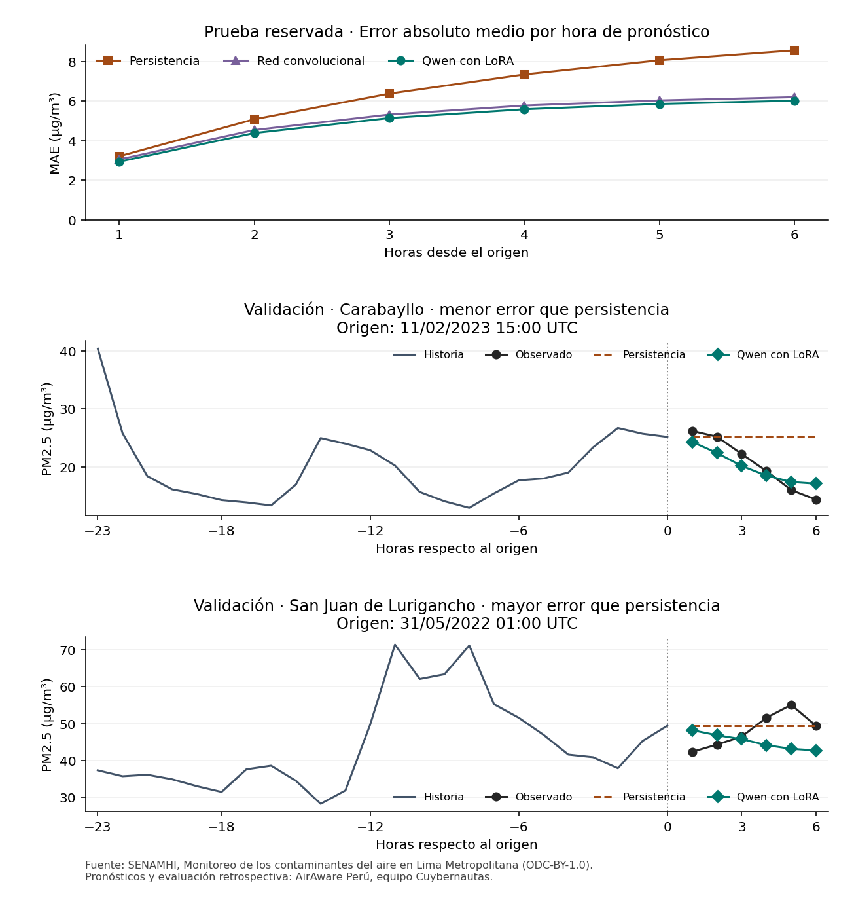

# Pronóstico de PM2.5 para las próximas seis horas en Lima

Con 24 horas de historia de PM2.5, Qwen3.5-0.8B con adaptación de bajo rango (LoRA) obtuvo un **error absoluto medio (MAE) de 4,994 µg/m³** en la prueba cronológica reservada. Repetir la última lectura produjo 6,446 µg/m³ y la red convolucional obtuvo 5,158 µg/m³. La reducción frente a persistencia fue **1,452 µg/m³ (22,52 %)**. Esta comparación mide pronósticos retrospectivos de estaciones de SENAMHI en Lima. [Resultados por modelo, estación y horizonte](../../metadata/qwen-heldout-lima.json).

## Prueba cronológica

La [selección del 19/11/2026](https://github.com/keneth-arias/airaware/pull/95) fijó los modelos, las referencias y la regla de evaluación antes de exportar las ventanas de prueba. Se verificó el manifiesto de TimeF y que los identificadores fueran disjuntos respecto de entrenamiento y validación. Los 50 789 orígenes cubren del 26/02/2023 a las 17:00 UTC al 29/05/2024 a las 20:00 UTC, con las discontinuidades de las estaciones. Qwen y la red convolucional recibieron los mismos 24 valores horarios por ventana. Los cinco métodos se evaluaron sobre los mismos seis objetivos por origen.

| Modelo | MAE global (µg/m³) | Diferencia frente a persistencia | MAE con concentración alta (µg/m³) |
| --- | ---: | ---: | ---: |
| Qwen directo con LoRA | **4,994** | **−1,452** | **18,371** |
| Red convolucional temporal | 5,158 | −1,288 | 18,434 |
| Persistencia | 6,446 | 0,000 | 19,616 |
| Misma hora del día anterior | 7,038 | +0,592 | 23,086 |
| Promedio de entrenamiento por serie y hora UTC | 8,269 | +1,823 | 34,144 |

Los cinco modelos comparten un denominador de 304 734 pares ventana-hora. Por el solapamiento, representan **51 319 horas de estación distintas**. Los objetivos se repiten cuando la misma lectura se pronostica desde orígenes sucesivos. Las diferencias son descriptivas para esta partición y una semilla de entrenamiento. Las tres referencias reprodujeron los MAE de prueba de [#25](../baselines/lima-pm25.md). Una segunda evaluación sobre los mismos archivos de inferencia reprodujo exactamente el informe y los hashes de los cinco archivos pareados.

Qwen redujo el MAE frente a persistencia en las siete estaciones provisionales y en las seis horas. La reducción fue de 0,272 µg/m³ a una hora y 2,542 µg/m³ a seis. Por estación varió de 0,768 µg/m³ en San Borja a 2,603 µg/m³ en Carabayllo. El percentil 95 fijado en entrenamiento identifica 10 574 objetivos de concentración alta que corresponden a 1772 horas de estación distintas. Allí la reducción fue de 1,244 µg/m³ (6,34 %). El error absoluto de Qwen siguió siendo elevado, 18,371 µg/m³.

## Insumo para la presentación del equipo



En el ejemplo de **Carabayllo**, ambos modelos parten de la misma historia. Qwen anticipa parte del descenso y reduce el MAE de la ventana en 3,04 µg/m³. En **San Juan de Lurigancho**, Qwen pronostica un descenso y pierde la subida de las últimas horas. Persistencia obtiene un MAE menor por 2,03 µg/m³. Ambos ejemplos se eligieron en validación por una regla de mediana, antes de la prueba. [Identificadores, orígenes y regla de selección](validacion-cabezales-qwen.md).

El caso de uso es anticipar la evolución horaria en estas estaciones cuando se cuenta con 24 lecturas consecutivas. La evaluación solo incluye ventanas completas. Se conservó la unidad inferida aceptada; la posición del intervalo, la calidad individual y la disponibilidad histórica en tiempo real siguen sin confirmación institucional. Usar estos resultados para alertas en vivo requeriría verificar esa disponibilidad y evaluar lecturas posteriores. Fuente: Servicio Nacional de Meteorología e Hidrología del Perú (SENAMHI). Datos bajo ODC-BY-1.0. Derivación y pronósticos del equipo Cuybernautas. [Atribución y licencia](../../DATA_ATTRIBUTION.md) · [Política de la fuente](../../docs/decisions/005-senamhi-operating-policy.md).

## Recursos y trazabilidad

La inferencia reservada de Qwen se ejecutó una vez en una RTX 5070 Ti, con FP32 y lote 16. SkyPilot registró 221,71 s desde el inicio del trabajo hasta su término. La red convolucional se ejecutó en CPU. Ambos archivos de pronósticos conservan el SHA-256 de su punto de control. En el estado final de LoRA se verificaron pesos B y segundos momentos del optimizador finitos y distintos de cero en las 24 proyecciones adaptadas de atención completa y las 90 recurrentes. Esta comprobación confirma que ambas familias recibieron actualizaciones. Se usó el núcleo de referencia de PyTorch. La [medición opcional de núcleos acelerados](https://github.com/keneth-arias/airaware/issues/96) queda para otro experimento.

## Reproducir la ronda

Se usó el manifiesto TimeF de [#22](../../tasks/issue-22-plan.md), la [selección congelada](../../configs/training/lima-pm25-finalistas-v1.yaml) y los archivos de [#25](../baselines/lima-pm25.md). Con los datos y los pesos locales preparados, crear una carpeta nueva. La exportación conserva los objetivos para calcular el error. Para inferencia se guardan únicamente el identificador y la historia de las 24 horas.

```bash
inputs=data/benchmarks/qwen-pm25-v1
out="$inputs/holdout-reproduccion"
mkdir "$out"
UV_OFFLINE=true uv run --project tools/timenet-smoke --locked python \
  tools/timenet-smoke/export_qwen_windows.py data/timef/airaware/lima-pm25-forecast/0.1.0 \
  "$out/test.npz" --split test > "$out/export.json"
UV_OFFLINE=true uv run --project tools/timenet-smoke --locked python - "$out" <<'PY'
from pathlib import Path
import sys
import numpy as np

out = Path(sys.argv[1])
with np.load(out / "test.npz", allow_pickle=False) as data, (out / "history.npz").open("xb") as f:
    np.savez(f, window_id=data["window_id"], history=data["history"])
PY
```

En el entorno de la red convolucional, ejecutar `python tools/training/predict_cnn.py "$inputs/fits/cnn/model.pt" "$out/history.npz" "$out/cnn.npz" --batch 16`. Para Qwen, usar la imagen y los pesos del manifiesto de finalistas, montar los pesos en `/inputs/qwen/weights` y el volumen retenido en `/checkpoints`. Desde la carpeta que contiene `history.npz`, ejecutar el comando siguiente y copiar la salida a `$out/qwen.npz`.

```bash
HF_HUB_OFFLINE=1 PYTHONPATH=/opt/forecast/src /opt/conda/bin/python -m opentslm.forecast_inference \
  --weights /inputs/qwen/weights --checkpoint /checkpoints/lima-fit-v1-direct-lora/step-00014837 \
  --data history.npz --output qwen.npz --batch 16
```

El comparador coteja la revisión incorporada en cada archivo de predicciones con la selección, verifica el manifiesto de #25 y une por identificador y hora. Comprueba también estación, origen UTC, valor observado y último valor de la historia. Los archivos pareados por modelo quedan en almacenamiento local. La figura usa el informe agregado y las dos ventanas de validación fijadas antes de la prueba.

```bash
UV_OFFLINE=true uv run --project tools/timenet-smoke --locked python \
  tools/timenet-smoke/evaluate_finalists.py "$out" data/benchmarks/lima-pm25-h24-f6-baselines \
  configs/training/lima-pm25-finalistas-v1.yaml "$out/resultado"
uv run --script tools/training/plot_forecast_results.py "$inputs" "$out/resultado/report.json" "$out/figura.png"
```

La primera instalación del entorno de figuras puede requerir red. Los pesos base de Qwen tienen la revisión `2fc06364715b967f1860aea9cf38778875588b17`. Para restaurar LoRA se necesitan los pesos base y el estado final fijado en la selección. Consultar el [procedimiento de entrenamiento](../../docs/qwen-cluster-runbook.md) y las [sumas de validación](../../metadata/qwen-validation-lora.json).
