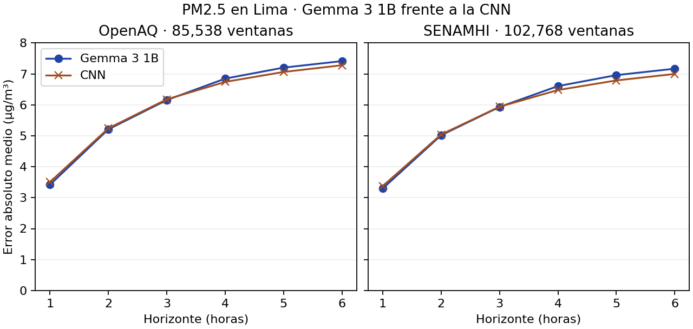

# Validación de Gemma para pronósticos de PM2.5

Resultados de los ajustes originales al 22 de noviembre de 2026. Los resultados de la activación privada y el pronóstico de Gemma 1B se actualizaron el 23 de noviembre. La confirmación histórica de
Gemma 3 1B conserva el control de error absoluto medio (MAE) en unidades físicas.
Para Flamingo con Gemma 3 4B, la validación de la versión `v4` conserva el
control de error cuadrático medio (MSE) normalizado. La comparación de
ponderación por picos de `v5` está en curso.

Los resultados también están disponibles como archivos JSON.

- [Validación por punto de control](../../metadata/resultados-gemma-20261122/validacion.json)
  reúne los pasos seleccionados, las huellas y las métricas disponibles por horizonte.
- [Pruebas](../../metadata/resultados-gemma-20261122/pruebas.json) registra las
  verificaciones del repositorio, la paridad bilingüe y las recuperaciones sintéticas.
- [Benchmark](../../metadata/resultados-gemma-20261122/benchmark.json) incluye la
  confirmación histórica de 1B frente a persistencia, la validación interna y los
  tiempos de ejecución de Flamingo v4, y el estado del benchmark externo con la CNN.

La figura usa las ventanas completas de cada archivo por separado. La [tabla de resultados](../../metadata/resultados-gemma-1b-20261123/benchmark.json) también registra los resultados posteriores, incluidos los cero ejemplos completos nuevos de OpenAQ. Los intervalos q96 siguen en evaluación.

## Gemma 3 1B en MicroK8s

Se usó `google/gemma-3-1b-pt` en la revisión
`fcf18a2a879aab110ca39f8bffbccd5d49d8eb29` con el entrenador OpenTSLM
`1bc3cb17cf431dd2d13e8632ff939d3406597096`. Todos los ajustes usaron 225 338
ventanas de entrenamiento, 6 664 de validación interna, 24 horas de historia y seis
de horizonte. El brazo ponderado asigna peso doble a los objetivos desde el
percentil 95 de cada estación, calculado solo con datos de entrenamiento.

Se evaluó cada 500 actualizaciones y se seleccionó por MAE global de validación.
Después del primer punto elegible, se requirió una mejora de al menos 0,02 µg/m³
para reemplazarlo. Los cinco ajustes terminaron por parada temprana tras cuatro
evaluaciones sin la mejora requerida. Cada variante tuvo 12 bloques de validación
con horas altas. El SHA-256 identifica el manifiesto del punto seleccionado.

| Semilla | Objetivo | Paso elegido | Paso final | MAE global (µg/m³) | MAE en horas altas (µg/m³) | SHA-256 del manifiesto seleccionado |
| --- | --- | ---: | ---: | ---: | ---: | --- |
| 27 | Error cuadrático medio (MSE) normalizado | 2 000 | 4 000 | 5,433 | 24,433 | `a741c2bca2b9169f5a2d7e2ce4382170900ecebae148d5810a2406f492ff4dd7` |
| 27 | MAE físico | 4 500 | 6 500 | 5,124 | 26,198 | `f1da0c412e9b918f8f4d8a11c8b6b5ee197150501b8e6ea97cd33be01d54304c` |
| 27 | MAE ponderado por picos | 4 500 | 6 500 | 5,103 | 24,382 | `b4e1959ff8731a371f5d52bc8d009f64f1eeee9ac5e3896824f251d6b15ef650` |
| 28 | MAE físico | 4 500 | 6 500 | 5,200 | 26,916 | `9a30bc75662e70d378739e316ab36ef26ec4aee286f144c490a4b31f04a18db1` |
| 28 | MAE ponderado por picos | 4 500 | 6 500 | 5,183 | 24,976 | `54a70f5b9dade415ddc59458d0eb4f73ff8bdeee33ebe00c003fb7e727629383` |

### Confirmación histórica

Los cuatro puntos de control de MAE de las semillas 27 y 28 se congelaron antes
de evaluar las 5 163 ventanas reservadas. La comparación tiene 30 978 pares de
ventana y horizonte, de los cuales 455 corresponden a 76 horas altas de estación.
La ponderación redujo el MAE en horas altas en 1,188 µg/m³, con un intervalo de
confianza al 95 % de 1,151 a 1,269 µg/m³ en cinco bloques semanales. El MAE global
aumentó 0,021 µg/m³. La regla registrada devolvió `retain_control`.

El registro de selección tiene SHA-256
`6019768d1a05bd5a77fe88590637d486d4f98b9dbc67d68d84dc96550797ba53`.
El informe de confirmación tiene SHA-256
`531a929333f7cdca619f8510de5889ff3502176768c40bcd8108c82d832c5988`.

### Pruebas de ejecución

- OpenTSLM aprobó 90 pruebas del entorno de pronóstico para esta revisión. La
  prueba local continua y la reanudada coincidieron en el estado del punto de
  control y la curva de 500 actualizaciones. MLflow registró 500 valores de
  pérdida únicos por ejecución.
- Dos restauraciones independientes devolvieron pronósticos idénticos para cinco
  historias sintéticas en los seis horizontes. También se restauró en un proceso
  nuevo cada uno de los tres puntos de control elegidos de la semilla 27.
- La prueba bilingüe comparó ocho casos en español e inglés y 43 tokens de
  referencia. Coincidieron los tokens elegidos y la diferencia máxima de
  log-verosimilitud negativa fue cero al repetir y al restaurar el punto sintético
  con manifiesto `f0ba9a51d8f685a6e4b0f6efeaac30aa6b2f0ead0f832f1df549424cf6b69895`.

En el seguimiento del optimizador, la receta con calentamiento y tasas separadas
restauró el paso 19 con manifiesto
`ab88997398305e8fd12a0fc7770101987c9b55820fdf5c3ec3f22834dd4f1eea`.
Coincidieron el estado y las 500 actualizaciones de la prueba sintética frente
a la ejecución continua.

Las tres recetas de optimización de MAE físico usaron los mismos lotes en
6 500 actualizaciones y coincidieron en la evaluación inicial. En los tres
casos, el punto elegido fue el paso 4 500 y la parada temprana ocurrió en el
paso 6 500. Las 6 664 ventanas de validación interna incluyeron 1 179 pares
de horas altas en 12 bloques semanales.

| Receta | MAE general (µg/m³) | MAE en horas altas (µg/m³) |
| --- | ---: | ---: |
| Base | 5,124 | 26,198 |
| Calentamiento | 5,141 | 26,578 |
| Calentamiento y tasas separadas | 5,195 | 26,564 |

La validación interna conservó la receta base. Se verificaron los archivos de
los puntos seleccionados. La comparación termina en esta etapa y conserva los
datos de confirmación para el protocolo ya registrado.

## Flamingo con Gemma 3 4B en Nebius

La imagen firmada `v4` usa la revisión de pronóstico
`0791047d28c28117a5a9f5e5a7591022f36c4648` y el índice
`sha256:ed9664a2ea2f23f9c16b1be9d7132ed085498c26285b8d7444c5442b12e95011`.
La prueba bilingüe registró una diferencia máxima de log-verosimilitud negativa de
cero entre repeticiones.

La prueba sintética reanudó desde la actualización 2 con el manifiesto
`6629d9c53e582acf70e8333e7424f15a2e0240f650546cac6c55376dc3b36395` y completó
500 actualizaciones. La ejecución continua y la reanudada coincidieron en 138
tensores del modelo, 414 del optimizador, dos del estado aleatorio, las
evaluaciones de los pasos 0 y 500 y los seis horizontes de pronóstico. El informe
de comparación tiene SHA-256
`eaa12339e47c86d2f3f38f55c8aa24e676b939a8db7bb081dcc86ece2695d841`.

### Ajustes reales de la semilla 27 en v4

Ambos ajustes terminaron por parada temprana en el paso 9 500. Cada punto
seleccionado en el paso 7 500 pasó dos restauraciones nuevas. La misma validación
interna aportó 6 664 ventanas, 39 984 pares de ventana y horizonte y 1 179 pares
de horas altas en 12 bloques semanales.

| Objetivo | MAE global (µg/m³) | MAE en horas altas (µg/m³) | SHA-256 del manifiesto seleccionado |
| --- | ---: | ---: | --- |
| MSE normalizado | 6,028 | 32,804 | `749902d8f49ffee36c208c85e3db3b3735a63f8ea49819298189f062f555ae5b` |
| MAE físico | 6,043 | 33,815 | `871dfa9cbc856c4e7f1c2d559526d8d55d1e2d37c4ecf1475395a78be14639e7` |

El criterio registrado devolvió `retain-control`. La comparación de `v4`
cerró sin replicación de semilla 28 ni evaluación de confirmación. El registro
de decisión tiene SHA-256
`78ddbd8214f23648387f8e692828ccdcbe0ede326f7ff07853dffa0436a3c7bd`.

### Calificación de v5

El índice de la imagen firmada es
`sha256:80d3c62e3dc7f4b4bcbae3f1165d68b2d0880c54d56fe0ac8c5d0153fedd94ee`.
La prueba bilingüe se completó con diferencia cero de log-verosimilitud
negativa entre repeticiones. La prueba sintética restauró el paso 2 con
manifiesto `e3edae3927a0bef39f1ca58aca9d0dfbdf5167611977dce9796d90dcb5b19c87`
y reprodujo las 500 actualizaciones de la referencia, incluidos el orden de los
lotes, la pérdida y la tasa de aprendizaje. Coincidieron las dos evaluaciones
y los seis horizontes, sin huecos en el registro de pérdida ni de tasa de
aprendizaje. El informe de comparación tiene SHA-256
`485a9bd36dbc7887413c8dbe00c036866fbd6d41954774337f32450102e69618`.
Los ajustes reales de la semilla 27 con MAE físico y MAE ponderado por picos
completaron la primera evaluación en el paso 500. Se verificó el mismo orden
de lotes en las primeras 500 actualizaciones de ambos ajustes. Sus resultados
terminales están pendientes.

## Evaluación por fuente

La red neuronal convolucional (CNN) entrenada es la referencia principal. El
conjunto histórico de calibración de 25 201 ventanas y sus tres pliegues
cronológicos purgados pasaron la verificación de entrada. Los dos archivos
históricos tienen insumos y pronósticos de la CNN verificados para una comparación
separada de PM2.5. [Registro de datos y huellas](../../metadata/lima-pm-externa-gemma-20261122.json).

| Fuente | Ventanas | Pares ventana–horizonte | Último objetivo completo | Reloj |
| --- | ---: | ---: | --- | --- |
| OpenAQ | 85 538 | 513 228 | 15/09/2026 11:00 | UTC |
| SENAMHI horario | 102 768 | 616 608 | 19/11/2026 20:00 | Hora publicada por SENAMHI |

La consulta acotada del archivo público de OpenAQ el 22/11/2026 a las 21:02 UTC
encontró cero archivos diarios para las ocho ubicaciones del conjunto entre
el 30/10 y el 22/11 inclusive. La fecha de la última lectura finita conocida
de PM sigue siendo el 29/10 a las 00:00 UTC. Las ventanas completas tienen un
corte anterior. [Archivo público de OpenAQ](https://docs.openaq.org/aws/about).

La captura operativa de SENAMHI para Campo de Marte incorpora 40 originales
verificados y 112 horas con lecturas finitas, hasta el 22/11 a las 15:00
en la hora publicada. La última recepción fue a las 20:09 UTC. Esta serie
operativa queda separada del archivo congelado y del futuro conjunto
independiente. Las secciones siguientes registran la evaluación final de Gemma 1B por fuente.

Las copias de los archivos congelados y las capturas operativas están bajo
`data/` en bm. Git registra los conteos y las huellas de verificación. Los pesos, las predicciones por ventana de las evaluaciones y los registros detallados se conservan en almacenamiento privado.

## Resultados finales de Gemma 1B y pronóstico de seis horas

Los resultados del 23 de noviembre se pueden descargar en JSON.

- [Validación](../../metadata/resultados-gemma-1b-20261123/validacion.json) del paquete y de los intervalos.
- [Pruebas](../../metadata/resultados-gemma-1b-20261123/pruebas.json) de restauración, paridad y ejecución.
- [Benchmark](../../metadata/resultados-gemma-1b-20261123/benchmark.json) de OpenAQ y SENAMHI, con pares, métricas por horizonte y decisiones.
- [Pronóstico](../../metadata/resultados-gemma-1b-20261123/pronostico.json) puntual de San Borja, con procedencia y hora de cálculo.

### Activación privada de los pronósticos puntuales de 1B

El 23 de noviembre de 2026 se activó el paquete bajo demanda en MicroK8s para +1 h a +6 h, con 24 horas de historia. Se usó el punto de control de MAE físico de la semilla 27 en la actualización 4 500, con la corrección de picos congelada. La CNN sigue a cargo de los pronósticos y alertas públicos.

| Artefacto | SHA-256 |
| --- | --- |
| Paquete verificado | `3b0eb55dada3fa67e68248c46c39b6c9f00f1006f53a7c5b92af39305a3d7de6` |
| Manifiesto del punto de control | `f1da0c412e9b918f8f4d8a11c8b6b5ee197150501b8e6ea97cd33be01d54304c` |
| Corrección de picos | `93bc57abc4b3840c4e59fc2d705fc91fa5b7d6872fd9bb81efdecc7bcd686ffc` |
| Referencia CNN | `9ceb6dcd793f661720fd58606992581857993f66109dc3024480e164316b7315` |

Dos restauraciones limpias reprodujeron los seis valores en las 85 538 ventanas de integridad y coincidieron con la prueba bilingüe. El escritor privado pasó cuatro pruebas sintéticas, incluido un reintento en cola durante una pausa. La calificación y la prueba del comando instalado devolvieron los mismos seis valores para una ventana SENAMHI. La diferencia absoluta máxima frente a la referencia fue menor que 0,0001 µg/m³. La revisión experimental de intervalos aprobó 171 pruebas de TimeNet sin servicios externos. La base de esta actualización aprobó 576 pruebas de AirAware y 88 pruebas de TimeNet, además de la construcción de paquetes y la auditoría de dependencias.

### Comparación de archivos congelados para Gemma 1B

Las horas altas se cuentan con el umbral de concentración fijado durante el ajuste. Cada registro contiene los mismos pares para Gemma corregido y la CNN. El criterio retrospectivo puntual utiliza 2 000 remuestreos pareados en bloques de 168 horas. El extremo superior del intervalo de confianza del 95 % del MAE general Gemma menos CNN debe ser inferior a +0,10 µg/m³. Para horas altas, el extremo inferior de la mejora CNN menos Gemma debe ser positivo.

| Fuente | Ventanas | Pares totales | Pares de horas altas | Bloques con horas altas | MAE Gemma / CNN | MAE alto Gemma / CNN |
| --- | ---: | ---: | ---: | ---: | ---: | ---: |
| OpenAQ congelado | 85 538 | 513 228 | 43 687 | 105 | 6,041 / 6,001 | 15,855 / 16,008 |
| SENAMHI archivado | 102 768 | 616 608 | 47 718 | 123 | 5,829 / 5,769 | 15,817 / 15,983 |

| Fuente | Diferencia de MAE general | IC del 95 % de la diferencia | Mejora de MAE alto | IC del 95 % de la mejora |
| --- | ---: | ---: | ---: | ---: |
| OpenAQ congelado | +0,03984 | [−0,00627, +0,08350] | +0,15244 | [+0,03401, +0,28080] |
| SENAMHI archivado | +0,05987 | [+0,01710, +0,09902] | +0,16645 | [+0,05410, +0,29045] |

Ambos archivos superaron los dos criterios retrospectivos puntuales. El margen corresponde al conjunto de cada fuente. Por horizonte, el comportamiento fue el siguiente, en µg/m³.

| Horizonte | OpenAQ Gemma | OpenAQ CNN | SENAMHI Gemma | SENAMHI CNN |
| ---: | ---: | ---: | ---: | ---: |
| +1 h | 3,420 | 3,505 | 3,296 | 3,375 |
| +2 h | 5,209 | 5,242 | 5,017 | 5,041 |
| +3 h | 6,154 | 6,178 | 5,931 | 5,938 |
| +4 h | 6,847 | 6,741 | 6,605 | 6,478 |
| +5 h | 7,203 | 7,062 | 6,960 | 6,788 |
| +6 h | 7,413 | 7,279 | 7,168 | 6,998 |

### Cobertura e intervalos en evaluación para Gemma 1B

La calibración v3 del Gemma corregido tuvo cobertura general de 91,81 % en OpenAQ y de 92,15 % en SENAMHI. El reajuste con cuantil superior q96 produjo 89,00 % y 89,39 %, respectivamente. Los dos resultados q96 excedieron el límite de 85 % para una banda nominal de 80 %. La cobertura en horas altas fue 80,21 % y 80,20 %. El q96 se registró para evaluación retrospectiva.

La prueba condicional usó 3 780 ventanas para ajustar, 4 123 para calibrar y 3 956 posteriores para evaluar. El MAE puntual de 11,223 µg/m³ coincidió entre calibradores. En 23 736 pares, la cobertura condicional fue 78,71 % en general y 67,86 % en horas altas. La cobertura de v3 en las mismas horas altas fue 80,45 %. El ancho medio en horas ordinarias bajó de 36,93 a 30,65 µg/m³. A +6 h, el ajuste condicional cubrió 58,19 % de 1 246 pares en horas altas frente a 74,56 % con v3. El criterio de horas altas falló.

Otros ensayos exploratorios evaluaron un cabezal conjunto, bandas asimétricas y una mezcla de corrección de picos. El cabezal conjunto redujo el MAE general frente a la CNN en ambos archivos, pero aumentó el MAE en horas altas. La mezcla eligió peso cero en los tres pliegues. El ajuste por aumento reciente de concentración redujo el MAE de horas altas en 0,593 µg/m³ sobre 58 080 pares, con un aumento global de 0,00235 µg/m³ que incumplió su criterio por pliegue. El reajuste corto de 128 actualizaciones aumentó ambos errores frente al cabezal conjunto. El paquete privado entrega pronósticos puntuales de la corrección seleccionada.

### Evaluación retrospectiva sobre archivos más recientes para Gemma 1B

Para OpenAQ se verificaron 257 objetos del archivo público después del corte anterior. Entre las 3 207 lecturas que cumplieron los filtros, hubo cero ventanas completas nuevas de 24 horas de historia y seis objetivos.

SENAMHI aportó 211 ventanas completas de seis estaciones, con objetivos del 21 al 22 de noviembre de 2026 según la hora publicada. El MAE general fue **3,734 µg/m³ para Gemma y 3,650 para la CNN**. La diferencia observada fue +0,08346 µg/m³. En 12 pares de horas altas, el MAE fue 22,325 para Gemma y 24,089 para la CNN. Esos pares pertenecen a un solo bloque de 168 horas. El mínimo registrado es de cuatro, por lo que no se estimaron los intervalos de confianza ni se aprobó la promoción.

Cada horizonte tiene 211 pares, dos de ellos en horas altas. Los resultados están en µg/m³.

| Horizonte | MAE Gemma | MAE CNN | MAE alto Gemma | MAE alto CNN |
| ---: | ---: | ---: | ---: | ---: |
| +1 h | 2,056 | 2,140 | 7,032 | 9,667 |
| +2 h | 3,129 | 3,119 | 21,250 | 22,271 |
| +3 h | 3,701 | 3,715 | 25,651 | 27,372 |
| +4 h | 4,203 | 4,065 | 26,243 | 27,897 |
| +5 h | 4,549 | 4,350 | 26,773 | 28,387 |
| +6 h | 4,765 | 4,514 | 27,003 | 28,942 |

### Pronóstico puntual para San Borja

MicroK8s en bm produjo el pronóstico de Gemma 1B a las **02:23:27 UTC del 23 de noviembre de 2026**. El origen fue el **22 de noviembre a las 21:00**, según el reloj publicado en el gráfico de SENAMHI. La entrada contiene 24 lecturas horarias consecutivas de PM2.5, sin imputaciones. El gráfico carece de un desfase explícito. Las fechas de destino conservan sus etiquetas y la hora de cálculo se registra en UTC. [Gráfico de SENAMHI](https://www.senamhi.gob.pe/site/sea/www/site/sea/graficas/dato_hora.php?estacion=00112270&cont=N_PM25&f1=21%2F11%2F2026&f2=23%2F11%2F2026)

| Horizonte | Hora publicada por SENAMHI | PM2.5 previsto (µg/m³) |
| --- | --- | ---: |
| +1 h | 2026-11-22 22:00 | 19,33 |
| +2 h | 2026-11-22 23:00 | 18,17 |
| +3 h | 2026-11-23 00:00 | 18,12 |
| +4 h | 2026-11-23 01:00 | 17,82 |
| +5 h | 2026-11-23 02:00 | 18,23 |
| +6 h | 2026-11-23 03:00 | 18,44 |

Este pronóstico puntual corresponde al paquete privado y se publica como resultado informativo para revisión.
